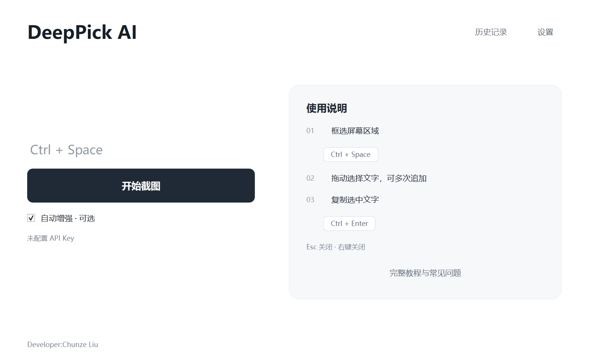

# DeepPick AI

**受 Mac Live Text 启发，为 Windows 做的一款屏幕文字提取工具。**

按下快捷键 → 框选屏幕 → 拖动选字 → 一键复制。

[下载 Windows 版](https://github.com/lcz1444532800-byte/DeepPick-AI/releases/latest) · [完整教程与常见问题](docs/使用说明.md)

## 能做什么

- 在截图原画面上选择文字，保留原字形，选中文字显示黄色高亮。
- 多次拖动追加选择，按阅读顺序复制。
- 使用随包提供的 PaddleOCR PP-OCRv4 模型进行本地识别，离线可用。
- 可接入自己的 **DeepSeek API**，进行校正、表格恢复、公式优化、翻译、总结和解释。
- 自动增强可开启或关闭；手动 AI 增强独立于自动开关。
- 托盘后台运行、可修改快捷键、最近 20 次历史与缓存自动清理。

## 开始使用

适用 **Windows 10 / 11 x64**。当前版本需要 **D 盘**，建议预留 1 GB 磁盘空间和 2 GB 可用内存。

1. 在 [Releases](https://github.com/lcz1444532800-byte/DeepPick-AI/releases/latest) 下载 **分享版 ZIP**。GitHub 自动生成的 “Source code” 是源码，不是可直接使用的软件包。
2. 完整解压到 **D:\\**，使程序位于 **D:\\DeepPickAI\\DeepPickAI.exe**。
3. 双击 **DeepPickAI.exe**。不需要安装 Python、下载模型或打开命令行。

不要在压缩包内运行，也不要只取出单独一个 EXE。

| 操作 | 默认快捷键 |
|---|---|
| 开始框选 | Ctrl + Space |
| 复制选中文字 | Ctrl + Enter |
| 关闭选区 | Esc / 鼠标右键 |
| 全选文字 | Ctrl + A |

多段选择直接再次拖动即可，Shift 无特殊作用。Ctrl + Space 与输入法冲突时，可在设置中修改。

桌面入口：右键 EXE → 显示更多选项 → 发送到 → 桌面快捷方式。

关闭首页后继续在托盘运行，彻底退出请右键托盘图标 → 退出。**开机自启默认开启**，可在设置 → 常规关闭。

## DeepSeek 增强 · 可选

在 **设置 → DeepSeek** 输入自己的 API Key，测试连接后保存。本地识别不需要 Key；未配置 Key 时不会调用 AI。

配置 Key 后，首页自动增强可对低质量识别自动请求 AI。截图后也可手动点击 **AI 增强**，即使自动开关关闭也可使用。

AI 请求会上传本次选区图像和识别文字，并使用自己的 DeepSeek API 额度。连接测试成功不代表实际图像调用已经通过。需要离线处理或不上传截图时，使用本地 OCR，关闭自动增强并不主动点击 AI 功能。

密钥隐藏显示，配置加密保存在 D 盘；历史文字与主动导出的文件由用户管理。分享包不包含开发者的密钥、配置、历史或截图。请转发原始 Release 包，避免分享使用后的安装目录。

## 存储与说明

应用、模型和运行数据都放在 D 盘。开机启动仅在 Windows 实际启动文件夹创建本产品快捷方式，该文件夹可能位于 C 盘。

缓存与临时文件合计默认上限 128 MB，每 5 分钟自动清理；缓存超过 7 天移除，日志合计最多 50 MB。模型保持预热以保证下一次响应，闲置时回收多余工作内存。

更完整的安装、AI 配置、更新、卸载和 **24 个常见问题**见 [使用说明](docs/使用说明.md)。下载包内有可离线打开的 HTML 教程，软件首页也可打开。

## 源码与运行组件

`app/source` 为模块化应用源码；`app/runtime` 在本仓库仅包含启动脚本，不包含大型 DLL 或运行库。运行组件和模型随 Release 提供。

当前发布入口使用未修改的 Python 官方嵌入式 GUI 运行时，保留其自身签名；应用源码没有独立发行签名。不同硬件、多屏混合缩放和安全策略仍需按实际环境验证。

开发与发布结构见 [开发说明](app/source/开发说明.md)。普通使用者直接下载 Release 即可。

## 反馈

遇到问题可在 [Issues](https://github.com/lcz1444532800-byte/DeepPick-AI/issues) 说明 Windows 版本、屏幕缩放、操作步骤和错误提示。截图请去掉敏感内容，不要提供 API Key、config 文件夹或个人识别历史。

## 授权与致谢

原创代码尚未指定开源许可证。第三方源码、模型及组件分别遵循其原有许可证，详见 [第三方说明](THIRD_PARTY_NOTICES.md)；Release 中附有许可证文本。

本项目参考 macOS Live Text 的取字体验，与 Apple 无关联，不包含 Apple 实现。离线 OCR 来自 PaddleOCR / RapidOCR 提供的模型，运行时使用 ONNX Runtime；界面使用 PySide6。

希望这个小工具能让大家用 Windows 时也更方便地取字。

Developer:Chunze Liu
